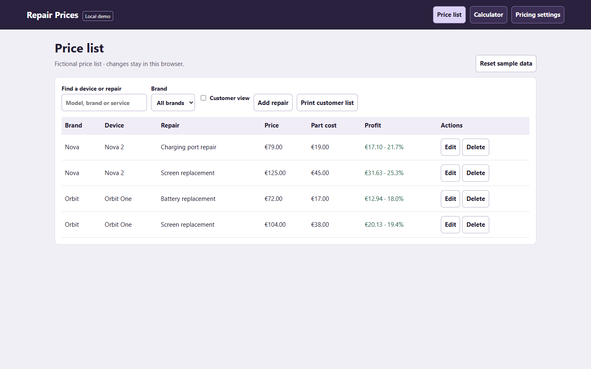

# Repair Prices

A local repair-price catalogue, customer price list and quote calculator. This clean edition follows the workflow and pricing model from the Repair Prices source at revision `63098c0`. It ships with fictional devices and prices.

## Run on your computer

1. Download this repository as a ZIP and extract it.
2. Install Node.js if needed. Double-click `Start-Local.cmd` on Windows or run `node local-server.cjs` in the extracted folder.
3. Open **http://127.0.0.1:8117/**.

Use **Price list** to add, edit, search or delete a repair. **Customer view** and the printed price list omit parts cost and profit. Use **Calculator** to estimate profit, margin and suggested price. **Pricing settings** stores your labour, shipping, tax and margin assumptions.

The default VAT mode divides the selling price by one plus the rate to calculate its net amount. Pick **Deduct a percentage of selling price** to reproduce the original calculator's deduction method. The suggestion rounds up to the next €5 step above the target-margin price. The demo rates are examples.

Edits stay in this browser. Reset restores the fictional catalogue. The app needs no user account or internet connection when run locally.

[Try the browser demo](https://repair-price-matrix-demo.ranakaharian1.workers.dev/).

The hosted demo uses the original matrix layout and supports a customer view, editable device rows and a quote calculator. The classic edition is in the classic folder.
